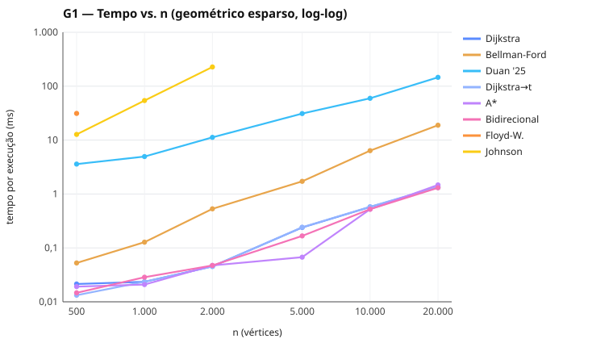
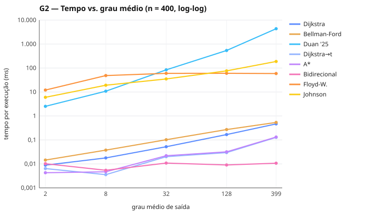
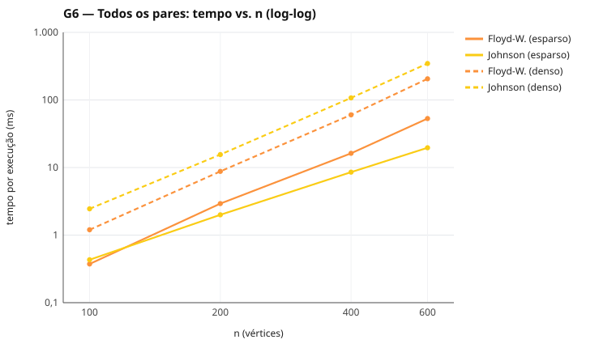
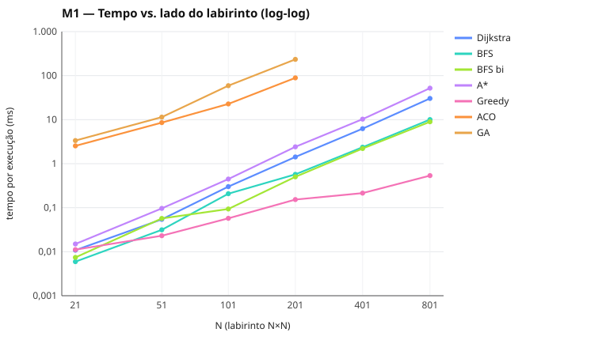
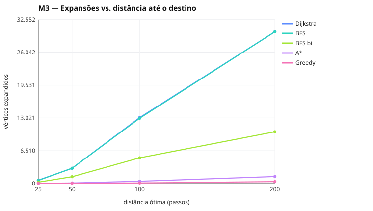
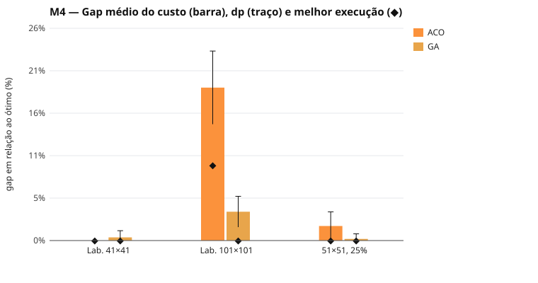

# Avaliação experimental do Graph Benchmark

Experimentos com os algoritmos do **benchmark de grafos** e do **benchmark de
labirintos**, com análise dos resultados, limitações encontradas e próximos passos
para o TCC.

- **Execução:** 02/11/2026.
- **Dados brutos:** [`dados/grafos.json`](dados/grafos.json) e
  [`dados/labirintos.json`](dados/labirintos.json).
- **Tabelas completas:** [`tabelas-geradas.md`](tabelas-geradas.md).
- **Gráficos:** [`figuras/`](figuras/).

Todos os números deste documento foram medidos. Nada foi estimado ou inventado.

---

## Sumário

1. [Metodologia](#1-metodologia)
2. [Correções feitas para garantir resultados confiáveis](#2-correções-feitas-para-garantir-resultados-confiáveis)
3. [Resultados e análise — grafos](#3-resultados-e-análise--grafos)
4. [Resultados e análise — labirintos](#4-resultados-e-análise--labirintos)
5. [Principais aprendizados](#5-principais-aprendizados)
6. [Limitações](#6-limitações)
7. [Próximos passos priorizados](#7-próximos-passos-priorizados)
8. [Como reproduzir](#8-como-reproduzir)

---

## 1. Metodologia

### 1.1 Como os experimentos usam a ferramenta

Os experimentos rodam por scripts em [`scripts/experiments/`](../../scripts/experiments),
que chamam **as mesmas funções que os Web Workers da interface executam**:

- `runGraphJob` ([`src/graph/benchmark/runner.ts`](../../src/graph/benchmark/runner.ts)) no
  benchmark de grafos;
- `solveMaze` ([`src/maze/algorithms/registry.ts`](../../src/maze/algorithms/registry.ts)) no
  benchmark de labirintos.

Assim, cada número é exatamente o que a interface mostraria para a mesma instância, e
dezenas de cenários podem ser repetidos sem cliques manuais.

| Aspecto | Interface | Experimentos |
|---|---|---|
| Código dos algoritmos e da medição | o mesmo | o mesmo |
| Isolamento | um Web Worker novo por algoritmo | um processo Node novo por algoritmo |
| Concorrência | algoritmos em sequência | algoritmos em sequência |
| Motor JavaScript | V8 (Chrome) | V8 (Node 22.13.1) |

### 1.2 Medição de tempo

A medição é igual para todos os algoritmos (`measureSamples` e `solveMaze`):

1. **Aquecimento** sem medir, até cerca de 150 ms, para o compilador JIT otimizar o
   código.
2. **Amostras:** 5 por padrão (3 nos cenários mais pesados). Cada amostra repete a mesma
   execução até o bloco durar pelo menos 2 ms, e o tempo da amostra é o do bloco dividido
   pelo número de repetições.
3. **Valor reportado:** a **mediana** das amostras, com o desvio padrão.

Só a lógica do algoritmo é medida. Montar a estrutura do grafo, calcular o fator da
heurística do A\* e extrair os resultados ficam fora do tempo, porque são
pré-processamento ou apresentação.

Nos algoritmos estocásticos (ACO e GA) há **10 execuções independentes** (sementes 1–10)
na mesma instância. Os resultados mostram sucesso, melhor resultado, média e desvio
padrão.

### 1.3 Métricas

| Métrica | Definição |
|---|---|
| Tempo | Mediana por execução (ms ou µs) |
| Vértices expandidos | Vértices processados, conforme a definição de cada algoritmo (ver a interface). No Duan, contados no grafo transformado; no ACO e no GA, somados entre formigas, gerações e indivíduos |
| Arcos examinados | Arestas percorridas pela busca |
| Relaxações | Vezes em que uma distância provisória diminuiu |
| Custo, células, gap | Gap = (custo − ótimo) / ótimo, com o Dijkstra como ótimo |
| Consistência | Distâncias de cada algoritmo comparadas às de uma referência exata no mesmo cenário |

**Consistência:** nenhuma divergência nos 228 resultados de grafos executados. Os outros 132, de 360 combinações de cenário e algoritmo, foram bloqueados por incompatibilidade ou limite de tamanho.

### 1.4 Ambiente

| Item | Valor |
|---|---|
| CPU | AMD Ryzen 7 9800X3D (8 núcleos / 16 threads) |
| Memória | 15 GB (alocados ao WSL2) |
| Sistema | Linux 6.6 (WSL2 no Windows) |
| Runtime | Node.js v22.13.1 (V8) |

### 1.5 Cenários

Todas as instâncias são geradas com **sementes fixas**.

| Id | Benchmark | O que varia | Instâncias |
|---|---|---|---|
| G1 | Grafos | Tamanho | Geométrico não direcionado, k = 3 vizinhos, n = 500…20.000 (o mesmo gerador da curva de crescimento) |
| G2 | Grafos | Densidade | Dirigido aleatório, n = 400, grau médio 2, 8, 32, 128 e 399 (completo) |
| G3 | Grafos | Pesos negativos | Dirigido esparso (E ≈ 2V) sem ciclo negativo, n = 200, 1.000 e 3.000 |
| G4 | Grafos | Estrutura acíclica | DAG (E ≈ 2V), com pesos positivos e com ~30% negativos, n = 1.000, 5.000 e 20.000 |
| G5 | Grafos | Pesos unitários | Grade não direcionada 30×30 e 100×100, todos os pesos = 1 |
| G6 | Grafos | Todos os pares | Esparso (geométrico) e denso (grau ≈ n/2), n = 100…600 |
| G7 | Grafos | Ciclo negativo | Dirigido esparso com ciclo 0 → 1 → 2 → 0 de soma −3, n = 500 |
| G8 | Grafos | Conectividade | Duas componentes de 5.000; a segunda é inalcançável |
| G9 | Grafos | Numeração dos vértices | Mesmo DAG com rótulos ordenados e embaralhados; grade com a origem no primeiro e no último índice |
| M1 | Labirintos | Tamanho | Labirinto gerado (braid 0,08), N = 21…801 |
| M2 | Labirintos | Estrutura dos obstáculos | 101×101: aberto, 25% e 40% aleatórios, labirinto perfeito, braid 0,08 e 0,30, armadilha em U |
| M3 | Labirintos | Distância início–destino | 201×201, 25% de obstáculos, destino a 25, 50, 100 e 200 passos |
| M4 | Labirintos | Algoritmos estocásticos | ACO e GA, 10 execuções, mais variações de parâmetros |

- Nos grafos, a origem é o vértice 0. O destino, nas buscas origem → destino, é o vértice
  mais distante em saltos (G1) ou o último índice (demais cenários).
- **Braid** é a fração de paredes removidas do labirinto gerado: 0 dá um "labirinto
  perfeito", com um único caminho entre quaisquer duas células; valores maiores abrem
  rotas alternativas.
- O ACO e o GA rodam no M1 só até N = 201, por causa do tempo.

---

## 2. Correções feitas para garantir resultados confiáveis

1. **Viés da numeração dos vértices nos geradores (corrigido na ferramenta).**
   - **O que aparecia:** na primeira rodada, o Bellman-Ford saiu mais rápido que o
     Dijkstra e até que o algoritmo próprio para DAG nos cenários G3, G4 e G8, terminando
     em 2 rodadas.
   - **Causa:** os geradores esparso, DAG, pesos negativos e desconexo sempre ligavam um
     pai de índice menor a um filho de índice maior. A ordem dos índices coincidia com uma
     ordem topológica, e o Bellman-Ford, que percorre os vértices nessa ordem, convergia
     numa única passada.
   - **Correção:** `shuffleLabels` em [`generators.ts`](../../src/graph/generators.ts)
     embaralha os rótulos 1…n−1, mantendo o 0 como raiz de onde todos continuam
     alcançáveis. Isso vale também para os modelos prontos da interface. O cenário G9 mede
     o efeito de propósito (seção 3.6).
2. **Cenário M3 vazio (erro no script, não na ferramenta).** A célula central do grid com
   25% de obstáculos estava isolada, então não havia destino a 25 ou mais passos. O início
   passou a ser a célula livre mais próxima do centro que alcança pelo menos 10.000
   células.
3. **Interface, sem efeito nos números:**
   - algoritmos indisponíveis agora mantêm a marcação visível;
   - a seção "Marcados, mas indisponíveis neste grafo" explica por que não rodaram;
   - o grid de seleção tem no máximo 3 cartões por linha.

---

## 3. Resultados e análise — grafos

### 3.1 Escalabilidade em grafos esparsos (G1)



**Tempo por execução (mediana):**

| n | Dijkstra | Bellman-Ford | Duan '25 | Dijkstra→t | A\* | Bidirecional | Johnson |
|---:|---:|---:|---:|---:|---:|---:|---:|
| 500 | 0,021 ms | 0,053 ms | 3,59 ms | 0,013 ms | 0,019 ms | 0,015 ms | 12,74 ms |
| 1.000 | 0,024 ms | 0,128 ms | 4,95 ms | 0,024 ms | 0,021 ms | 0,029 ms | 54,11 ms |
| 2.000 | 0,046 ms | 0,531 ms | 11,24 ms | 0,045 ms | 0,047 ms | 0,047 ms | 227 ms |
| 5.000 | 0,239 ms | 1,72 ms | 31,05 ms | 0,242 ms | 0,067 ms | 0,167 ms | n/e |
| 10.000 | 0,574 ms | 6,37 ms | 59,62 ms | 0,579 ms | 0,521 ms | 0,523 ms | n/e |
| 20.000 | 1,32 ms | 18,89 ms | 146 ms | 1,36 ms | 1,47 ms | 1,30 ms | n/e |

"n/e" = não executado por estar acima do limite (Johnson: 2.000 vértices; Floyd-Warshall:
600, só aparece em n = 500, com 31,25 ms).

**Vértices expandidos:**

| n | Dijkstra | Bellman-Ford | Duan '25 | Dijkstra→t | A\* | Bidirecional |
|---:|---:|---:|---:|---:|---:|---:|
| 500 | 500 | 5.623 | 9.636 | 492 | 298 | 346 |
| 5.000 | 5.000 | 116.213 | 102.055 | 4.998 | 1.814 | 3.358 |
| 20.000 | 20.000 | 1.288.582 | 401.096 | 20.000 | 13.537 | 15.271 |

**Dijkstra:** de n = 500 a 20.000 (40×), o tempo cresceu 63×. É compatível com O((V + E)
log V), que prevê cerca de 40 × 1,6 ≈ 64×. Há um salto entre 2.000 e 5.000 (0,046 →
0,239 ms, 5,2× para 2,5× de n), provavelmente efeito de cache: os arrays deixam de caber
nos níveis mais rápidos. É uma hipótese; não foi medido.

**Bellman-Ford:** cresceu 356× para os mesmos 40×. O limite O(V·E) é pessimista porque o
algoritmo para quando uma rodada não muda nada. As rodadas medidas cresceram de 17
(n = 500) para 104 (n = 20.000), acompanhando o número de arestas do caminho mínimo mais
longo, que num grafo geométrico cresce perto de √n. O custo real fica perto de
rodadas × E ≈ n^1,5, e 40^1,5 ≈ 253, mesma ordem dos 356× medidos.

**Duan et al. (experimental):**
- É de ~100× a ~245× mais lento que o Dijkstra em todos os tamanhos.
- Cresceu 41× para 40× de n, o que é consistente com o artigo (O(m log^(2/3) n)).
- A razão Duan/Dijkstra caiu de ~170–240× (n ≤ 2.000) para ~100–130× (n ≥ 5.000). Isso
  coincide com o salto de cache do Dijkstra, então **não dá para atribuir a queda à
  vantagem assintótica**.
- Ele examina cerca de 5,5 arcos do grafo transformado por arco, em todos os tamanhos (ver
  seção 3.2 para o caso denso).

**Buscas origem → destino:**
- O A\* teve a maior vantagem em n = 5.000: 3,6× mais rápido que o "Dijkstra até o
  destino", com 1.814 expansões contra 4.998.
- Em n = 20.000 o A\* foi **mais lento** (1,47 contra 1,36 ms), mesmo expandindo 32% menos
  vértices. Como o destino é o vértice mais distante em saltos, a busca tem de cobrir boa
  parte do grafo de qualquer jeito. Além disso, o fator calibrado da heurística foi
  c = 0,0429 (≈ 1/23), abaixo do 1/20 com que os pesos foram gerados, porque o
  arredondamento cria arestas "baratas" que limitam c. A heurística fica conservadora e o
  custo de calculá-la por vértice anula o ganho.
- O Dijkstra bidirecional ficou entre os dois: ganhou em n = 5.000 (0,167 ms) e empatou
  nos maiores.

**Johnson:** cresce cerca de 4,2× por duplicação de n, como esperado de
O(V·E·log V) com E ∝ V.

### 3.2 Densidade (G2, n = 400)



| Grau médio | Dijkstra | Bellman-Ford | Duan '25 | Floyd-W. | Johnson |
|---:|---:|---:|---:|---:|---:|
| 2 | 8,86 µs | 14 µs | 2,52 ms | 12,05 ms | 6,01 ms |
| 8 | 18 µs | 38 µs | 10,8 ms | 48,5 ms | 19,18 ms |
| 32 | 52 µs | 102 µs | 83,9 ms | 59,9 ms | 35,03 ms |
| 128 | 167 µs | 271 µs | 540 ms | 60,3 ms | 76,28 ms |
| 399 (completo) | 467 µs | 538 µs | 4.367 ms | 58,9 ms | 188 ms |

- **Dijkstra e Bellman-Ford** crescem quase linearmente com E. Num grafo completo o
  Bellman-Ford fica perto do Dijkstra (538 contra 467 µs): com diâmetro 1, ele converge em
  poucas rodadas.
- **Floyd-Warshall** se estabiliza perto de 60 ms a partir de grau 32. É Θ(V³): depende
  só de n, não de E. No grafo completo ele é 3,2× mais rápido que o Johnson (58,9 contra
  188 ms).
- **Duan** é o algoritmo que mais sofre com a densidade:
  - de grau 2 para 399, o tempo cresce 1.730× (contra 53× do Dijkstra);
  - os arcos examinados por arco do grafo transformado sobem de 5,2 para 101,5;
  - as chamadas recursivas, de 1,5 mil para 1,8 milhão.

  A transformação para grau constante cria uma cópia do vértice por vizinho, ligadas em
  ciclos de peso 0. No grafo completo são ciclos de 399 cópias, e o algoritmo reprocessa
  muito mais. É um custo prático que a análise assintótica do artigo não mostra.
- **Buscas origem → destino** dependem muito de onde o destino cai. Com grau 8, o destino
  ficou a poucos saltos e o "Dijkstra até o destino" examinou só 45 arcos. O
  **bidirecional** examinou no máximo 798 arcos em todos os graus, porque em grafos densos
  as duas frentes se encontram quase imediatamente.

### 3.3 Pesos negativos e DAGs (G3, G4)

**G3, sem ciclo negativo:** como esperado, só o Bellman-Ford, o Johnson e o Floyd-Warshall
puderam rodar; os demais foram bloqueados com o motivo.

| n | Bellman-Ford | Johnson | Floyd-Warshall |
|---:|---:|---:|---:|
| 200 | 6,45 µs | 1,52 ms | 1,29 ms |
| 1.000 | 41 µs | 53,2 ms | n/e |
| 3.000 | 111 µs | n/e | n/e |

Com os rótulos embaralhados, o Bellman-Ford precisou de poucas rodadas: 755 expansões para
n = 200, cerca de 3,8 rodadas. Em grafos aleatórios os caminhos mínimos têm poucas arestas,
então o pior caso O(V·E) fica longe.

**G4, DAG:** o algoritmo próprio é o mais rápido entre os de origem única, como prevê o
seu O(V + E):

| n | Dijkstra | Bellman-Ford | DAG | Duan '25 |
|---:|---:|---:|---:|---:|
| 20.000 (pesos ≥ 1) | 1,73 ms | 2,10 ms | **0,85 ms** | 118 ms |
| 20.000 (com negativos) | não pode | 2,41 ms | **0,85 ms** | não pode |

Os tempos do DAG são praticamente iguais com e sem negativos: ele não depende do sinal dos
pesos. Nas buscas origem → destino, o bidirecional chegou a 0,024 ms em n = 20.000, contra
0,151 ms do "Dijkstra até o destino", porque nesses DAGs o destino fica a poucos saltos.

### 3.4 Pesos unitários (G5)

| Grade | BFS | Dijkstra | Bellman-Ford | A\* | Bidirecional |
|---|---:|---:|---:|---:|---:|
| 30×30 | 11 µs | 21 µs | 18 µs | 25 µs | 28 µs |
| 100×100 | 95 µs | 299 µs | 194 µs | 508 µs | 428 µs |

- **BFS** é o mais rápido (3,1× o Dijkstra na grade 100×100), com o mesmo número de
  expansões. A diferença é toda da estrutura de dados: uma fila simples contra a fila de
  prioridade.
- **A\*** quase não poupa expansões (9.805 contra 10.000), porque o destino é o canto
  oposto e a distância euclidiana subestima o número de passos na grade. E fica 1,7× mais
  lento que o Dijkstra, pelo custo da heurística.
- **Bellman-Ford** aparece mais rápido que o Dijkstra só porque a origem é o índice 0, num
  canto, e a numeração é linha por linha. É o mesmo viés de ordem medido no G9. A grade não
  foi embaralhada para manter os rótulos legíveis no editor (ver Limitações).

### 3.5 Todos os pares (G6)



| n | FW esparso | Johnson esparso | FW denso | Johnson denso |
|---:|---:|---:|---:|---:|
| 100 | 0,374 ms | 0,432 ms | 1,2 ms | 2,45 ms |
| 200 | 2,93 ms | 2,0 ms | 8,77 ms | 15,55 ms |
| 400 | 16,2 ms | 8,54 ms | 60,2 ms | 107 ms |
| 600 | 53,1 ms | 19,6 ms | 206 ms | 346 ms |

A teoria se confirma:
- **Grafos esparsos:** o Johnson vence a partir de n ≈ 200 e já é 2,7× mais rápido em
  n = 600.
- **Grafos densos:** o Floyd-Warshall vence em todos os tamanhos, por 1,7× a 2×.
- **Crescimento:** o Floyd-Warshall sobe cerca de 140–170× de n = 100 para 600 (6× em n;
  o cúbico daria 216×). O Johnson no esparso sobe 45×, perto de n² log n.

O Floyd-Warshall é cúbico e independe de E, enquanto o Johnson depende de V·E·log V. O
ponto em que um passa a vencer o outro está na densidade em que E log V se aproxima de V².

### 3.6 Numeração dos vértices (G9)

| Cenário | Bellman-Ford | Rodadas | DAG | Dijkstra |
|---|---:|---:|---:|---:|
| DAG 20.000, rótulos ordenados | 0,512 ms | 2 | 0,857 ms | 1,72 ms |
| DAG 20.000, rótulos embaralhados | 1,94 ms | 11 | 0,860 ms | 1,72 ms |
| Grade 100×100, origem no índice 0 | 2,32 ms | 20 | — | 0,731 ms |
| Grade 100×100, origem no último índice | 9,86 ms | 200 | — | 0,751 ms |

- **O Bellman-Ford é o único sensível à ordem dos vértices:** de 2 para 11 rodadas no DAG
  e de 20 para 200 na grade.
- **Dijkstra e DAG não mudam:** o Dijkstra depende só da fila de prioridade, e o DAG calcula
  a própria ordem topológica.
- **Consequência metodológica:** comparações com o Bellman-Ford precisam controlar a
  numeração, ou concluem algo sobre o gerador e não sobre o algoritmo.

### 3.7 Ciclo negativo e grafo desconexo (G7, G8)

- **G7:** o Bellman-Ford detectou o ciclo e marcou as distâncias afetadas com −∞ em
  1,62 ms, executando todas as rodadas (248.646 expansões ≈ n²). O Floyd-Warshall também
  detectou (24,7 ms) e os dois concordaram. O Johnson foi bloqueado antes de rodar, porque a
  análise prévia já tinha encontrado o ciclo (3 vértices).
- **G8:** todos os algoritmos de origem única expandiram só os 5.000 vértices alcançáveis
  e marcaram os outros 5.000 como ∞.
  - O Dijkstra bidirecional examinou mais (7.838 expansões), porque a frente que parte do
    destino explora a outra componente antes de concluir que não há caminho.
  - Isso mostra um caso em que a busca bidirecional é pior que a unidirecional.

---

## 4. Resultados e análise — labirintos

Nos labirintos todo movimento custa 1, então BFS, BFS bidirecional, A\* e Dijkstra sempre
encontraram o custo ótimo.

### 4.1 Tamanho (M1)



| N | Dijkstra | BFS | BFS bi | A\* | Greedy | ACO (média) | GA (média) |
|---:|---:|---:|---:|---:|---:|---:|---:|
| 21 | 0,011 ms | 5,9 µs | 7,4 µs | 0,015 ms | 0,011 ms | 2,54 ms | 3,35 ms |
| 101 | 0,301 ms | 0,208 ms | 0,093 ms | 0,447 ms | 0,057 ms | 22,8 ms | 59,2 ms |
| 201 | 1,42 ms | 0,572 ms | 0,502 ms | 2,41 ms | 0,153 ms | 89,1 ms | 234 ms |
| 801 | 30,3 ms | 10,05 ms | 8,95 ms | 52,0 ms | 0,536 ms | n/e | n/e |

**Gap do custo em relação ao ótimo:**

| N | Greedy | ACO (melhor \| média) | GA (melhor \| média) |
|---:|---:|---:|---:|
| 21 | +4,2% | 0% \| +2,1% | 0% \| +3,3% |
| 51 | +18,7% | 0% \| +0,3% | 0% \| 0% |
| 101 | +25% | +2,1% \| +5,6% | 0% \| +2,2% |
| 201 | +27,5% | +26% \| +40,9% | +9,7% \| +17,3% |
| 401 | +32% | n/e | n/e |
| 801 | +37% | n/e | n/e |

- **BFS e BFS bidirecional** são os mais rápidos entre os exatos: 3× e 3,4× o Dijkstra em
  N = 801. Como no G5, a vantagem é a fila simples no lugar da fila de prioridade.
- **A\* é mais lento que o Dijkstra em todos os tamanhos de labirinto** (1,7× em N = 801),
  embora expanda 10% menos (308.388 contra 341.513). Em labirintos a distância Manhattan
  orienta mal: o caminho real dá muitas voltas, e o custo de calcular a heurística supera a
  pequena economia.
- **Greedy** é de 29× a 57× mais rápido que o Dijkstra nos labirintos grandes (N ≥ 401),
  mas o custo piora com o tamanho (+4% para +37%). É a troca clássica entre rapidez e qualidade.
- **ACO e GA** são de 2 a 3 ordens de grandeza mais lentos. A qualidade cai bastante em
  N = 201: o ACO fica com +41% em média. A partir de N = 51, o GA teve melhor qualidade
  média que o ACO, mas foi mais lento.

### 4.2 Estrutura dos obstáculos (M2, 101×101)

**Expansões e gap** (ACO e GA: melhor execução, com a média entre parênteses):

| Estrutura | Dijkstra | A\* | Greedy (gap) | ACO (gap) | GA (gap) |
|---|---:|---:|---:|---:|---:|
| Aberto | 10.201 | **201** | 201 (0%) | 0% (+1,2%) | 0% (0%) |
| 25% aleatórios | 7.481 | 520 | 280 (+14%) | +3% (+6,1%) | +1% (+2,3%) |
| 40% aleatórios | 3.729 | 2.607 | 600 (+13,9%) | +2,8% (+5,4%) | 0% (+0,4%) |
| Labirinto perfeito | 5.201 | 5.191 | 4.273 (0%) | 0% (0%) | 0% (0%) |
| Braid 0,08 | 5.517 | 5.150 | 1.678 (+38,5%) | +5,1% (+10,2%) | +1,3% (+9,5%) |
| Braid 0,30 | 6.388 | 2.032 | 244 (+9%) | +8% (+12,4%) | 0% (+3,1%) |
| Armadilha em U | 9.973 | 3.583 | 2.823 (+42,3%) | 0% (+2,5%) | 0% (+0,8%) |

- **O valor do A\* depende inteiramente de quanto os obstáculos atrapalham a heurística:**
  - no grid aberto expandiu só o caminho (201 células, 50× menos que o Dijkstra);
  - com 25% de obstáculos, 14× menos;
  - em labirintos estreitos, quase nada.
- **Labirinto perfeito:** como há um único caminho, todos os algoritmos acharam o ótimo,
  inclusive o Greedy, o ACO e o GA.
- **Armadilha em U:** o Greedy entra no "U", porque a heurística aponta para o destino, e
  sai com +42% de custo. O A\* expande 3.583 células, mas mantém o ótimo.
- **Mais rotas alternativas (braid maior)** ajudam o A\*, porque a heurística passa a ser
  mais informativa, e dificultam o ACO, porque há mais rotas quase ótimas competindo pelo
  feromônio.

### 4.3 Distância entre início e destino (M3)



| Distância | Dijkstra | BFS bi | A\* | Greedy |
|---:|---:|---:|---:|---:|
| 25 | 673 | 282 | 36 | 28 |
| 50 | 3.028 | 1.355 | 113 | 71 |
| 100 | 13.096 | 5.102 | 460 | 115 |
| 200 | 30.141 | 10.274 | 1.396 | 388 |

- **Dijkstra** expande uma área que cresce com o quadrado da distância, até começar a
  esgotar a região alcançável.
- **A\*** cresce de forma bem mais lenta e expande 19× a 29× menos. Aqui o A\* é **11× mais
  rápido** que o Dijkstra (0,244 contra 2,69 ms na distância 200): com destino próximo e
  obstáculos esparsos, o ganho em expansões supera o custo da heurística, ao contrário do
  M1.
- **BFS bidirecional** corta as expansões pela metade ou mais. É coerente com explorar
  duas "bolas" de raio d/2 no lugar de uma de raio d.

### 4.4 Algoritmos estocásticos (M4)



| Instância | Algoritmo e variante | Melhor (gap) | Média ± dp (gap) | Tempo médio |
|---|---|---:|---:|---:|
| Labirinto 41×41 | ACO padrão | 102 (0%) | 102 ± 0 (0%) | 6,3 ms |
| Labirinto 41×41 | GA padrão | 102 (0%) | 102,4 ± 0,8 (+0,4%) | 9,0 ms |
| Labirinto 101×101 | ACO padrão | 282 (+9,3%) | 306,8 ± 11,7 (+18,9%) | 25,1 ms |
| Labirinto 101×101 | ACO, 100 iterações | 274 (+6,2%) | 294 ± 14,7 (+14%) | 61,8 ms |
| Labirinto 101×101 | ACO, 60 formigas | 284 (+10,1%) | 298,4 ± 9,4 (+15,7%) | 72,6 ms |
| Labirinto 101×101 | GA padrão | 258 (0%) | 267,2 ± 4,9 (+3,6%) | 72,3 ms |
| Labirinto 101×101 | GA, 300 gerações sem estagnação | 258 (0%) | 262,6 ± 2,7 (+1,8%) | 304 ms |
| Labirinto 101×101 | GA, população 90 | 258 (0%) | 264,8 ± 5,8 (+2,6%) | 190 ms |
| Grid 51×51, 25% | ACO padrão | 100 (0%) | 101,8 ± 1,8 (+1,8%) | 7,8 ms |
| Grid 51×51, 25% | GA padrão | 100 (0%) | 100,2 ± 0,6 (+0,2%) | 13,0 ms |

- **Sucesso:** 100% em todos os casos. Nos dois algoritmos as rotas são construídas por
  busca em profundidade com retrocesso, que sempre termina num caminho válido.
- **Instâncias pequenas:** os dois chegam ao ótimo. **Médias:** o GA chega ao ótimo e o ACO
  não.
- **Mais esforço melhora pouco e custa caro:**
  - ACO com 3,3× mais iterações: gap médio de 18,9% para 14%, com 2,5× o tempo;
  - GA com 300 gerações: de 3,6% para 1,8%, com 4,2× o tempo.
- **A variabilidade é relevante** (desvio padrão de 5 a 15 de custo no 101×101), o que
  justifica as execuções repetidas.
- **Comparação com o Dijkstra:** o GA leva 72 ms no 101×101 contra ~0,3 ms do Dijkstra, que
  ainda garante o ótimo. Nesta classe de problema, as metaheurísticas não têm vantagem
  prática. Fazem sentido em variantes NP-difíceis (vários destinos, restrições, vários
  objetivos), não aqui.

---

## 5. Principais aprendizados

1. **Constantes e estruturas de dados pesam tanto quanto a complexidade.**
   - BFS contra Dijkstra em pesos unitários: mesmas expansões, 3× mais rápido, só pela fila.
   - A\* contra Dijkstra em labirintos: menos expansões e mesmo assim mais lento.
   - Duan contra Dijkstra: assintoticamente melhor e de ~100× a ~245× mais lento.
2. **O Dijkstra é uma referência muito difícil de vencer** em grafos com pesos ≥ 0 nos
   tamanhos testados. Só o algoritmo próprio para DAG (O(V + E)), o BFS (pesos unitários) e
   as buscas origem → destino, que fazem menos trabalho, o superaram.
3. **Buscas origem → destino dependem muito da instância.** A\* e bidirecional variaram de
   cerca de 6× mais rápidos a mais lentos que o Dijkstra até o destino, conforme a posição do
   destino, a qualidade da heurística e a densidade. Um único caso não basta para comparar.
4. **O pior caso nem sempre aparece na prática, e a ordem dos dados importa.** O Bellman-Ford
   ficou muito longe do O(V·E) em grafos aleatórios e foi muito sensível à numeração dos
   vértices (G9).
5. **A escolha entre algoritmos de todos os pares depende da densidade,** como a teoria
   prevê: Johnson para grafos esparsos, Floyd-Warshall para densos.
6. **Duan et al.:** a implementação experimental confirma o crescimento quase linear em
   grafos esparsos, mas degrada muito com a densidade, por causa da transformação para grau
   constante. A análise assintótica não mostra esse custo.
7. **Metaheurísticas não competem com algoritmos exatos em caminho mínimo:** são mais
   lentas e não garantem o ótimo. Servem para mostrar a troca entre qualidade e esforço e a
   variabilidade entre execuções.
8. **Metodologia:** aquecimento do JIT, isolamento por algoritmo, mediana, verificação de
   consistência e controle de vieses dos geradores mudaram as conclusões. Sem isso, o
   benchmark teria declarado o Bellman-Ford mais rápido que o Dijkstra.

---

## 6. Limitações

- **Node, não navegador:** os números vêm do Node 22 (V8), no WSL2. O código é o mesmo da
  interface, mas o Chrome e outros sistemas podem ter constantes diferentes. Os números de
  referência de um TCC deveriam ser confirmados no navegador (ver a seção 7).
- **Uma instância por configuração:** a variabilidade medida é a de tempo entre amostras,
  não a entre instâncias diferentes do mesmo tipo de grafo. Conclusões gerais pedem várias
  instâncias por ponto (seção 7).
- **Resolução de tempo:** valores abaixo de ~10 µs dependem da repetição em blocos e ficam
  mais sujeitos a ruído e a efeitos de cache.
- **Vieses de gerador ainda presentes:**
  - grade e cadeia continuam numeradas em ordem, o que favorece o Bellman-Ford com a origem
    no índice 0 (G5, G9);
  - o destino "último índice" é arbitrário e muda o resultado das buscas origem → destino
    (G2).
- **Heurística do A\* nos grafos:** depende das posições no editor e do fator calibrado,
  que fica conservador quando os pesos são arredondados. Uma heurística melhor mudaria os
  resultados do A\*.
- **Contagens não comparáveis entre todos os algoritmos:** as expansões do Duan (grafo
  transformado) e do ACO/GA (somadas entre agentes) não equivalem às dos algoritmos
  clássicos.
- **Parâmetros do ACO e do GA:** só os padrões e duas variações; não houve ajuste
  sistemático.
- **ACO e GA limitados a N ≤ 201 no M1**, por causa do tempo.
- **Memória não medida:** o navegador não oferece medição confiável por execução.
- **Duan et al.:** implementação experimental; os tempos refletem esta implementação, não o
  algoritmo de forma geral (ver
  [`breaking-sorting-barrier/BENCHMARK_INTEGRATION.md`](../../breaking-sorting-barrier/BENCHMARK_INTEGRATION.md)).

---

## 7. Próximos passos priorizados

Esforço: **B** = baixo (até ~1 dia), **M** = médio (alguns dias), **A** = alto (semanas).

### 7.1 Importantes (recomendados para o TCC)

| # | Sugestão | Benefício esperado | Esforço |
|---|---|---|---|
| 1 | **Várias instâncias por configuração** nos scripts (ex.: 10 sementes de grafo por ponto), com média e intervalo de confiança | Conclusões estatisticamente defensáveis, independentes de uma instância "sortuda" | B |
| 2 | **Validar os números no navegador:** rodar alguns cenários pela interface com puppeteer e comparar com o Node | Responde à principal ameaça à validade (Node ≠ Chrome) | B |
| 3 | **Exportar resultados (CSV/JSON) pela interface** e mostrar a semente usada | Experimentos feitos na UI viram dados para o texto do TCC | B |
| 4 | **Importar grafos reais** (formato DIMACS `.gr` de redes viárias ou extratos do OpenStreetMap) | Aplicação prática concreta (roteamento); A\* e bidirecional avaliados no cenário para o qual foram criados | M |
| 5 | **Pesos nos labirintos** (custo por célula; o modelo já suporta `costs`) | Diferencia BFS (deixa de ser ótimo) de Dijkstra e A\*; cenários de "terreno" | M |
| 6 | **Controle de vieses nos geradores:** opção de embaralhar rótulos também em grade e cadeia, e escolher o destino por critério (mais distante, aleatório) | Remove os vieses restantes (seção 6) | B |

### 7.2 Valiosos, mas não essenciais

| # | Sugestão | Benefício esperado | Esforço |
|---|---|---|---|
| 7 | **Algoritmo de Dial / fila por baldes** (pesos inteiros pequenos) e **Dijkstra com outras filas** (pairing heap, radix heap) | Mostra como a estrutura de dados muda o desempenho, o principal aprendizado destes experimentos | B–M |
| 8 | **Heurísticas melhores para o A\*:** ALT (marcos com desigualdade triangular); nos labirintos, Jump Point Search | Avalia a qualidade da heurística, que foi o fator decisivo do A\* | M |
| 9 | **Visualização passo a passo** da exploração (frentes, células visitadas ao longo do tempo) | Valor didático para a apresentação | M |
| 10 | **Otimizar o Duan et al.:** arrays tipados, seleção linear, estrutura do Lemma 3.3 completa, transformação implícita | Comparação teoria × prática mais justa; contribuição original possível | A |
| 11 | **Curva de crescimento com vários tipos de grafo** (densidade, DAG, pesos negativos) na interface | O que os experimentos G2–G4 mostraram passa a estar disponível na UI | M |

### 7.3 Opcionais

| # | Sugestão | Benefício esperado | Esforço |
|---|---|---|---|
| 12 | **Contraction Hierarchies** para consultas repetidas em grafos tipo mapa | Técnica moderna usada em roteamento; pré-processamento versus consulta | A |
| 13 | **Versões em WebAssembly** de alguns algoritmos | Compara o custo do JavaScript com código nativo | A |
| 14 | **Memória** via `performance.measureUserAgentSpecificMemory` (exige isolamento de origem cruzada) | Métrica pedida originalmente; ainda imprecisa por execução | M |
| 15 | **Teste de regressão de desempenho** (rodar `scripts/experiments` em CI e comparar) | Evita que mudanças futuras piorem tempos sem perceber | M |
| 16 | **Variantes NP-difíceis** (vários destinos, caminho com restrições), onde ACO e GA fazem sentido | Dá às metaheurísticas um cenário em que elas têm vantagem real | A |

---

## 8. Como reproduzir

```bash
# 1. Executa todos os cenários (um processo por algoritmo) e grava docs/experimentos/dados/*.json
node scripts/experiments/run.mjs          # ou: run.mjs graph | run.mjs maze

# 2. Gera tabelas-geradas.md e figuras/*.svg a partir dos dados
node_modules/.bin/vite-node scripts/experiments/report.ts
```

| Arquivo | Conteúdo |
|---|---|
| [`scenarios.ts`](../../scripts/experiments/scenarios.ts) | Definição dos cenários e das sementes |
| [`runAlgorithm.ts`](../../scripts/experiments/runAlgorithm.ts) | Executa um algoritmo em todos os cenários com `runGraphJob` / `solveMaze` |
| [`run.mjs`](../../scripts/experiments/run.mjs) | Orquestra os processos e grava os dados brutos |
| [`report.ts`](../../scripts/experiments/report.ts) | Tabelas, consistência e gráficos |

Os tempos absolutos variam entre máquinas; as relações entre algoritmos e as contagens
(expansões, arcos, relaxações) devem se manter.
